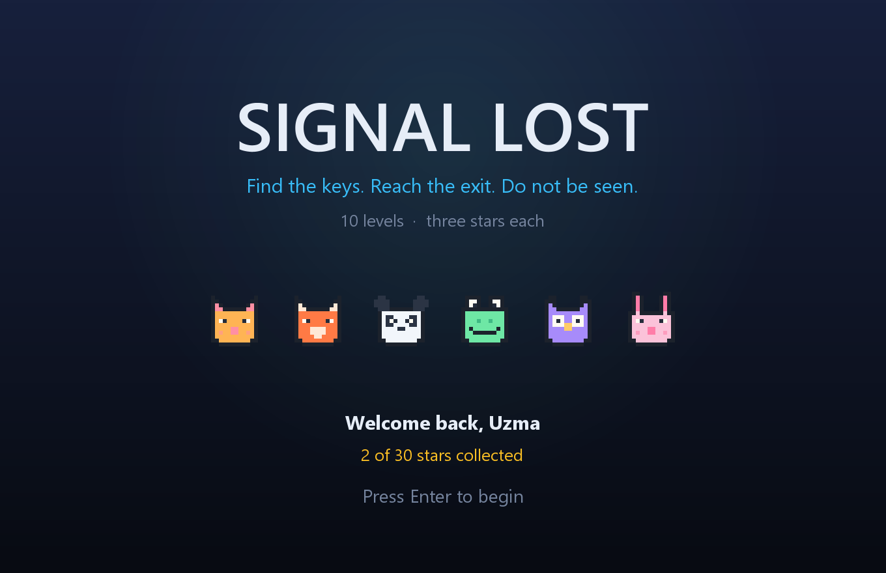
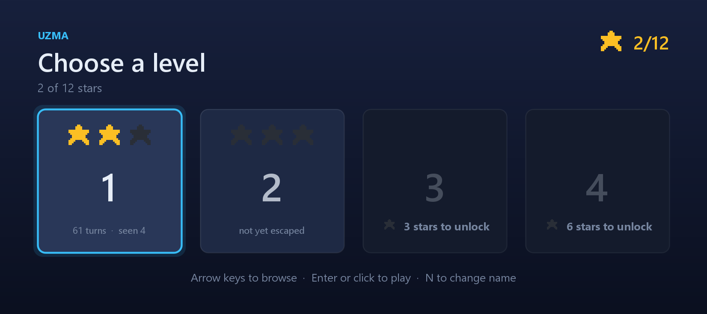
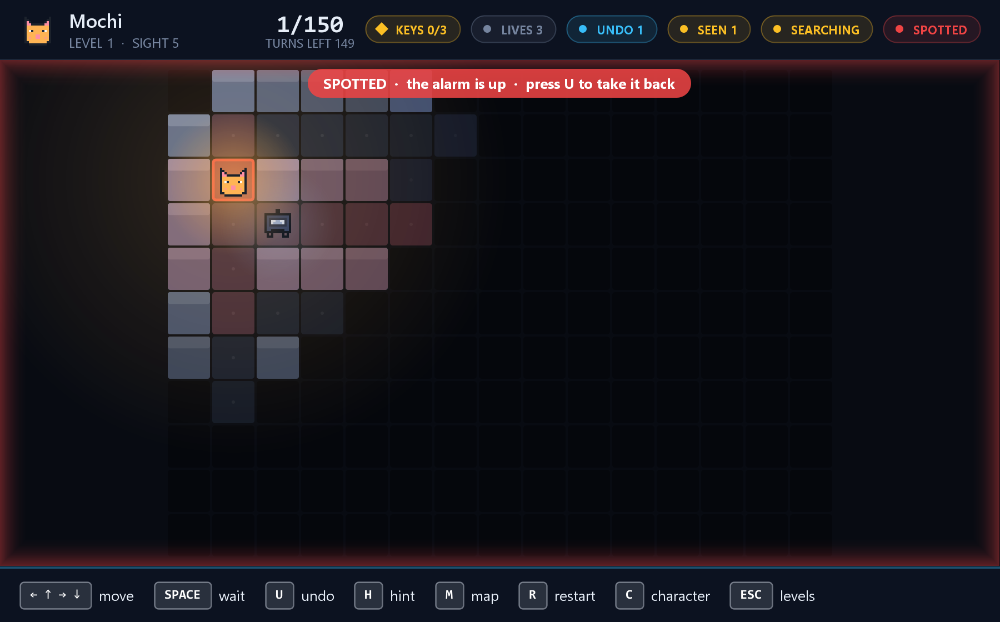
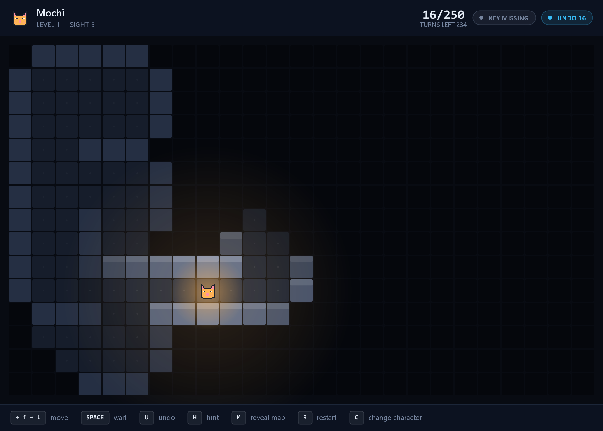
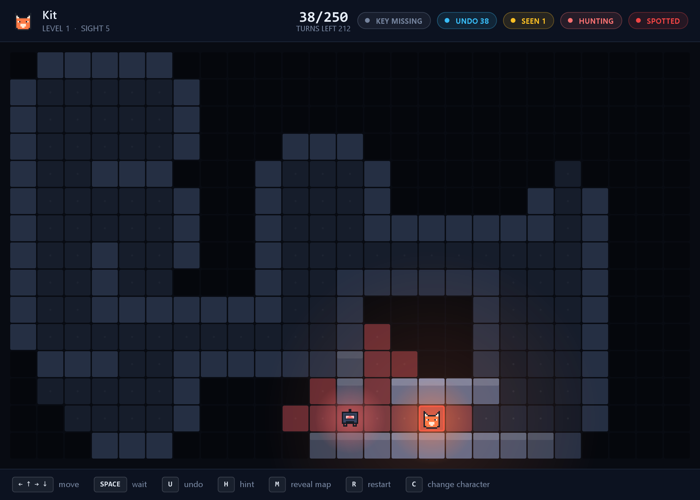
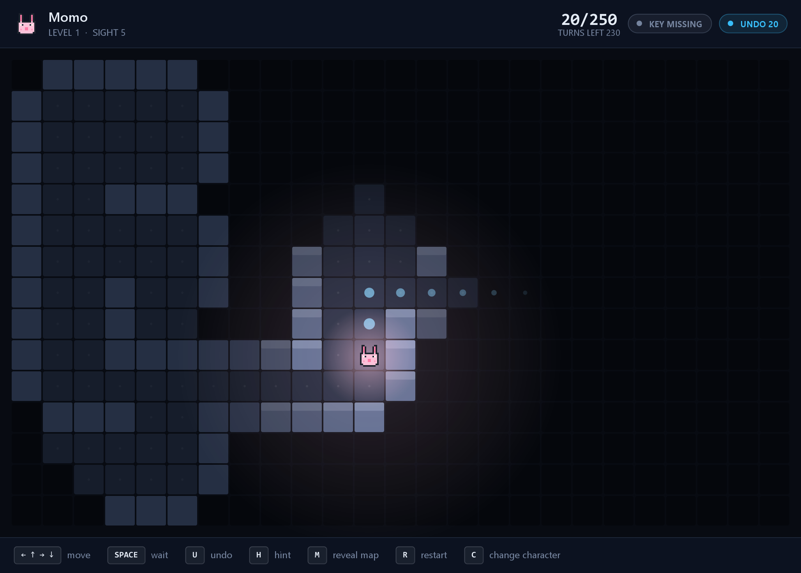
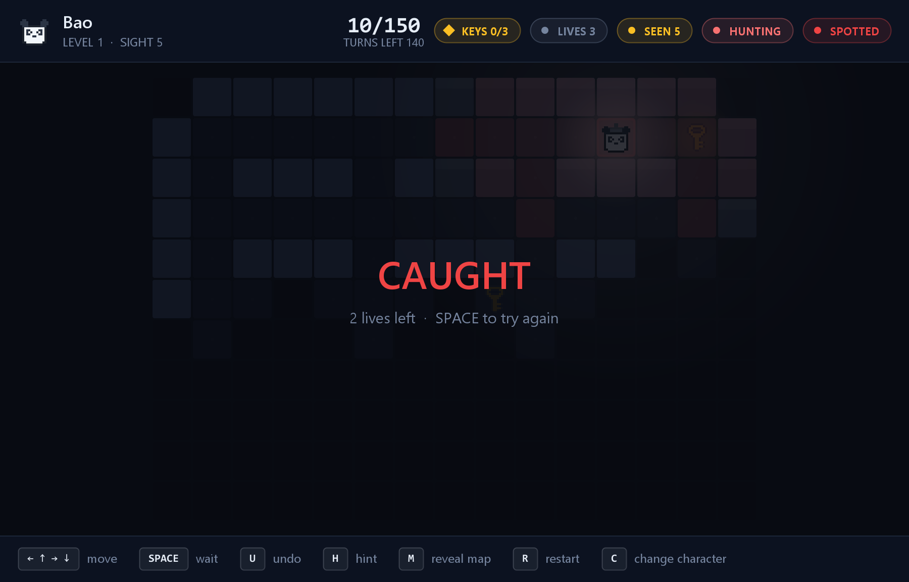
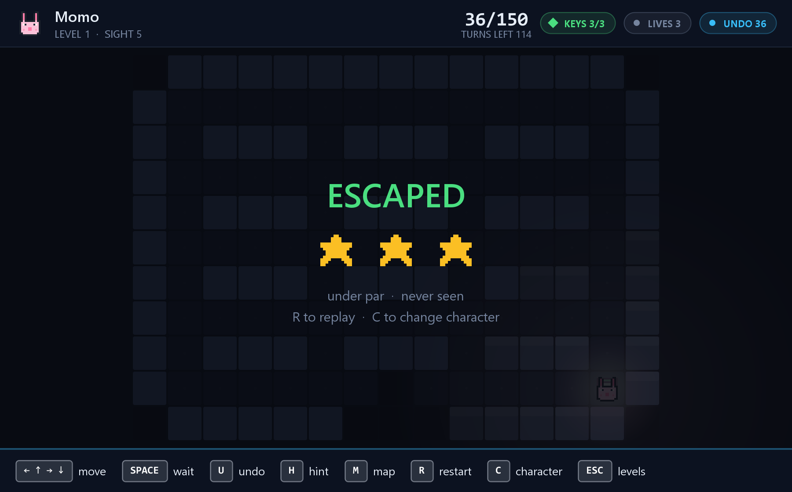
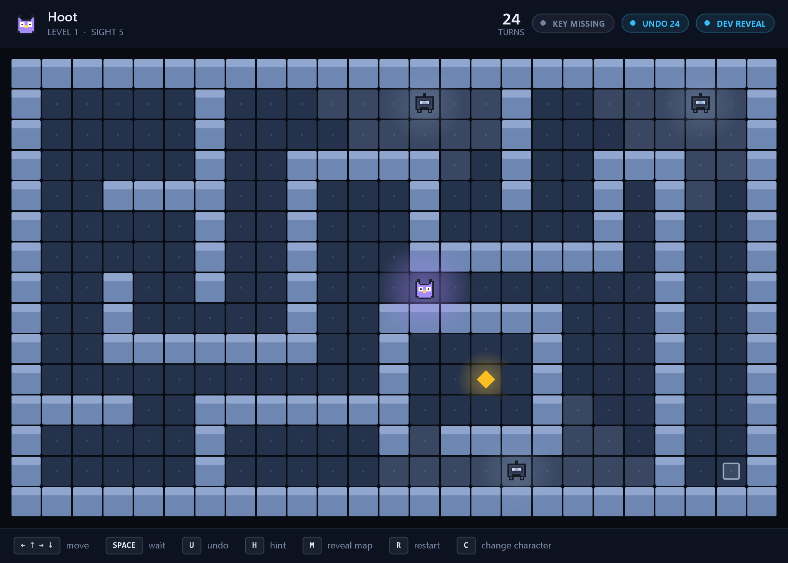

# Signal Lost — A Fog-of-War Stealth Strategy Game

*Course project report source. This file holds the written content in the order
the SESD template requires; `docs/report-build.py` turns it into the formatted
Word document. Diagrams live in [uml.md](uml.md) and are rendered to images at
build time.*

| | |
| --- | --- |
| Course | Software Engineering and System Design (24CS301PC311) |
| Programme | III Year, I Semester B.Tech-CSE |
| Student | Uzma Yasmeen |
| Hall ticket | `TO BE SUPPLIED` |
| Supervisor | `TO BE SUPPLIED` |
| Department | Computer Science & Artificial Intelligence |
| Institution | SR University, Warangal, Telangana, India |
| Session | 2026-2027 |

---

## 1. Abstract

Signal Lost is a turn-based stealth strategy game written in Java, in which a
player escapes a facility they can only partly see. The map is hidden by a fog
of war computed as a breadth-first flood fill from the player's position, so
sight stops at walls and bends around corners; tiles already visited remain as
a dimmer memory of their terrain but not of their occupants. Guards patrol
fixed routes, raise an alarm when they sight the player, and a hunter answers
that alarm by pursuing with A\* search over a priority queue.

The project was undertaken to demonstrate graph algorithms, classical design
patterns and layered architecture in a single artefact whose behaviour is
inspectable rather than hidden inside animation. Because the game is turn-based
and fully deterministic, every decision it makes is plain, testable logic. Five
design patterns carry the structure: Command for undoable turns, Strategy for
guard behaviours, State for guard modes, Observer for the alarm, and Factory for
guards and levels.

The delivered system comprises ten levels, six playable characters, a three-life
run structure, a limited hint system, a star rating derived from turns taken and
times seen, and per-player saved progress. It is verified by 205 automated tests
across 25 test classes, including an architectural test that fails the build if
the game rules ever reference the user interface, and a fairness test that
proves every level is winnable. Level difficulty was calibrated not by play but
by an exhaustive breadth-first search of the entire game tree, which established
that a winning line exists on every level and how short the shortest one is.

**Keywords:** fog of war, breadth-first search, A\* pathfinding, design
patterns, Command pattern, layered architecture, deterministic simulation,
automated verification.

---

## 2. Introduction

### 2.1 Problem Statement

Student game projects are usually built in real time, and real time hides the
software engineering. When a character slides across the screen sixty times a
second, the interesting decisions — what can be seen, where an opponent moves,
whether a rule was broken — are buried inside animation loops and frame timing.
The result is a project that is hard to explain, hard to draw in UML, and nearly
impossible to unit-test, because almost nothing can be isolated from the
rendering that drives it.

A second, subtler problem affects games built this way: **nobody can prove they
are playable.** A level is declared finished when its author manages to complete
it, which conflates "difficult" with "impossible" and leaves genuine design
faults undetected. A level whose only key sits behind a door that never opens,
or whose three-star rating cannot be achieved by any sequence of moves, will
pass every unit test ever written for it, because unit tests check that rules
behave — not that the game those rules produce can actually be won.

Signal Lost addresses both problems. The game is turn-based, so every decision
is a discrete, inspectable step rather than a frame of animation. The rules are
written without any reference to the display, so they can be exercised without
opening a window. And because the simulation is deterministic, the game can be
*searched* rather than merely played: the entire space of possible games on a
level can be enumerated to answer whether that level can be won at all.

### 2.2 Objectives

The project set out to achieve the following, in order of priority:

1. **Implement fog of war as a graph traversal.** Compute visibility as a
   breadth-first flood fill bounded by a sight radius and blocked by walls, and
   retain seen terrain as persistent memory distinct from current visibility.

2. **Implement pursuit as informed search.** Drive hunting guards with A\*
   search using a Manhattan-distance heuristic and a priority queue, with
   deterministic tie-breaking so identical situations resolve identically.

3. **Demonstrate design patterns where they are genuinely warranted**, rather
   than inserted for display: Command to make turns undoable, Strategy to
   separate guard behaviour from guard identity, State for mode transitions,
   Observer to propagate the alarm, and Factory to construct guards and levels
   from data.

4. **Keep the game rules independent of the user interface**, and enforce that
   independence automatically so it cannot be eroded by a single convenient
   import.

5. **Verify behaviour by automated test**, covering visibility, pathfinding,
   undo, detection, capture, scoring and persistence.

6. **Verify playability by exhaustive search**, establishing that every level
   has a winning line and that its star thresholds are attainable.

7. **Deliver a complete, playable product** — multiple levels, progression,
   saved progress and a finished interface — rather than a technical
   demonstration.

### 2.3 Scope

**Within scope.** A single-player desktop game consisting of: a grid-based level
model; breadth-first visibility with persistent fog memory; patrolling and
hunting guards with a three-state mode machine and an observer-driven alarm; A\*
pathfinding; a command-stack turn system supporting exact undo; collectible keys
gating an exit; a three-life run structure; a limited hint system; a star rating
computed from turns taken and sightings incurred; ten levels with star-gated
unlocking; per-player saved progress held locally; a Swing user interface with
title, name-entry, character-selection, level-selection and play screens; and an
automated test suite.

**Outside scope.** The system performs no network communication, stores no data
remotely, and provides no account system, multiplayer, or audio. A Spring Boot
and PostgreSQL leaderboard with daily levels is identified as a second phase and
is not implemented; phase 1 constrains itself only so far as keeping completed
runs expressible as plain data, so that such a backend remains possible without
restructuring.

**Known limitations.** One of the three guard types described in the original
proposal — a stationary sentinel with a rotating vision cone — is not
implemented; the extension points it would use exist and are documented. No
accessibility conformance is claimed. These and other gaps are recorded in full
in Section 6.3 of the accompanying Software Requirements Specification rather
than omitted.

---

## 3. Software Requirements Specification

This section states the requirements in summary. The complete specification —
including rationale for each derived requirement, a full traceability matrix,
and a record of requirements deliberately not met — is held in the repository as
[`docs/srs.md`](srs.md).

Requirements marked **(D)** are *derived*: they did not appear in the original
proposal and were added after playtesting exposed a fault that the stated
requirements permitted. Each is traced to the automated test that enforces it.

### 3.1 Functional Requirements

**FR-1 Visibility and fog of war**

| ID | Requirement | Verified by |
| --- | --- | --- |
| FR-1.1 | Visible tiles are computed by breadth-first flood fill from the player, bounded by a sight radius of 5 | `VisibilityServiceTest` |
| FR-1.2 | Walls block the fill; sight does not pass through them | `VisibilityServiceTest` |
| FR-1.3 | A wall bounding a visible tile is itself visible, so rooms read as enclosed | `VisibilityServiceTest` |
| FR-1.4 | A tile once seen remains drawn as remembered terrain, without its occupants | `FogOfWarTest` |
| FR-1.5 | A developer toggle reveals the entire map for testing | `FogOfWarTest` |

**FR-2 Turns and movement**

| ID | Requirement | Verified by |
| --- | --- | --- |
| FR-2.1 | A turn is one player action followed by one move from every guard, in that order | `TurnWithGuardsTest` |
| FR-2.2 | The player moves one orthogonally adjacent tile per turn, or waits | `GameStateTest` |
| FR-2.3 | A move into a wall or off the grid is refused and consumes no turn | `GameStateTest` |
| FR-2.4 | A move onto a guard is refused; guards obstruct movement | `TurnWithGuardsTest` |
| FR-2.5 | Each level imposes a turn limit, after which the attempt fails | `TurnLimitTest` |

**FR-3 Guards**

| ID | Requirement | Verified by |
| --- | --- | --- |
| FR-3.1 | A patroller walks a fixed route between two points, reversing at each end | `GuardTest` |
| FR-3.2 | A hunter advances towards the player's last known position using A\* | `GuardTest`, `AStarPathfinderTest` |
| FR-3.3 | A guard occupies exactly one of three modes: PATROL, ALERT, HUNT | `GuardTest` |
| FR-3.4 | **(D)** A hunter advances two tiles on alternate turns, gaining on a fleeing player | `GuardTest` |
| FR-3.5 | A hunter that loses the player returns to PATROL after searching | `AlarmTest` |

**FR-4 Detection and the alarm**

| ID | Requirement | Verified by |
| --- | --- | --- |
| FR-4.1 | A turn ending with the player inside any guard's line of sight counts as a sighting | `SpottingTest` |
| FR-4.2 | Watched tiles are drawn in red where visible to the player | *manual* |
| FR-4.3 | A sighting raises an alarm, placing every hunter into HUNT mode through an observer | `AlarmTest` |
| FR-4.4 | Sightings accumulate across the whole run, not per attempt | `ScoreTest` |

**FR-5 Capture and lives**

| ID | Requirement | Verified by |
| --- | --- | --- |
| FR-5.1 | A guard in HUNT mode reaching the player captures them | `CaptureTest` |
| FR-5.2 | **(D)** A guard not in HUNT mode obstructs but does not capture | `CaptureTest` |
| FR-5.3 | A run begins with three lives; each capture costs one | `LivesTest` |
| FR-5.4 | A new life resets player, keys, guards and clock, but not the sighting count | `LivesTest` |
| FR-5.5 | Exhausting the last life ends the run | `LivesTest` |

**FR-6 Keys and the exit**

| ID | Requirement | Verified by |
| --- | --- | --- |
| FR-6.1 | A level may hold several keys; all are required | `MultipleKeysTest` |
| FR-6.2 | Entering a key's tile collects it and removes it from the map | `MultipleKeysTest` |
| FR-6.3 | The exit remains closed until every key is held | `MultipleKeysTest` |
| FR-6.4 | Reaching an open exit ends the attempt as an escape | `GameStateTest` |

**FR-7 Undo**

| ID | Requirement | Verified by |
| --- | --- | --- |
| FR-7.1 | Every turn is recorded as a command object on a stack | `UndoTest` |
| FR-7.2 | Undo restores player, guards, alarm state, sighting count, keys and clock | `UndoTest` |
| FR-7.3 | Undo repeats back to the start of the attempt | `UndoTest` |
| FR-7.4 | Undo is refused once the attempt has ended | `UndoTest` |
| FR-7.5 | **(D)** The query "can I undo?" agrees with what undo actually does | `UndoTest` |

**FR-8 Hints**

| ID | Requirement | Verified by |
| --- | --- | --- |
| FR-8.1 | A hint indicates one move, never a route | `HintTest` |
| FR-8.2 | A hint expires when the player moves | `HintLifetimeTest` |
| FR-8.3 | Under observation, the hint points towards cover rather than the objective | `HintCoverTest` |
| FR-8.4 | Otherwise it points along a guard-avoiding route to the nearest key, then the exit | `HintTest` |
| FR-8.5 | **(D)** A level permits three hints | `HintBudgetTest` |
| FR-8.6 | **(D)** Neither undo nor a new life restores a spent hint | `HintBudgetTest` |

**FR-9 Scoring**

| ID | Requirement | Verified by |
| --- | --- | --- |
| FR-9.1 | A failed attempt scores zero stars | `ScoreTest` |
| FR-9.2 | Escaping scores one star | `ScoreTest` |
| FR-9.3 | Escaping within par scores a second | `ScoreTest` |
| FR-9.4 | Escaping unseen scores a third | `ScoreTest` |
| FR-9.5 | Par is derived from level geometry, not written into the level file | `ScoreTest` |
| FR-9.6 | **(D)** Three stars are attainable on every level | `StarRatingAchievableTest` |

**FR-10 Levels and progression**

| ID | Requirement | Verified by |
| --- | --- | --- |
| FR-10.1 | Ten levels of increasing size are provided | `LevelIntegrityTest` |
| FR-10.2 | Every level is winnable: all keys and the exit are reachable from the start | `LevelIntegrityTest` |
| FR-10.3 | **(D)** Every watched tile has cover within reach, so being seen is always survivable | `LevelFairnessTest` |
| FR-10.4 | Levels unlock at 0, 1, 3, 5, 8, 11, 14, 17, 20 and 23 stars | `LevelIntegrityTest` |
| FR-10.5 | The level list is data; adding a level requires no code change | `LevelIntegrityTest` |

**FR-11 Players and saved progress**

| ID | Requirement | Verified by |
| --- | --- | --- |
| FR-11.1 | A player enters a name under which progress is stored | `ProgressTest` |
| FR-11.2 | The best result per level per player is retained | `ProgressTest` |
| FR-11.3 | Saving one player's progress does not disturb another's | `ProgressTest` |
| FR-11.4 | An unrecognised name starts from zero | `ProgressTest` |
| FR-11.5 | Progress is written only to the local machine | `ProgressTest` |
| FR-11.6 | A missing, empty or malformed save file is treated as "no progress", never as a visible error | `ProgressTest` |

### 3.2 Non-Functional Requirements

| ID | Category | Requirement | Verified by |
| --- | --- | --- | --- |
| NFR-1 | Performance | A turn resolves fast enough to feel instantaneous on a 29×21 grid | *manual; no measured budget* |
| NFR-2 | Maintainability | No class in `model`, `vision`, `pathfinding`, `guard`, `level` or `progress` imports `java.awt`, `javax.swing` or `java.applet` | `ArchitectureTest` |
| NFR-3 | Testability | The entire test suite runs without opening a window | `ArchitectureTest` |
| NFR-4 | Reliability | The simulation is deterministic: identical input from identical state yields an identical result | `TurnWithGuardsTest` |
| NFR-5 | Portability | `ProgressStore` accepts a storage path from its caller, so a platform without a home directory can supply one | `ArchitectureTest` |
| NFR-6 | Privacy | The system transmits no data and requires no network | *by inspection* |
| NFR-7 | Usability | Every key bound to an action is named on screen during play | *manual* |

> **On NFR-2 and NFR-4.** These two are the load-bearing requirements. NFR-2 is
> what permits the whole suite to run headless, and what would permit an Android
> port to reuse the rules unchanged. NFR-4 is what makes exhaustive verification
> possible, and therefore what makes FR-9.6 and FR-10.2 checkable rather than
> merely asserted.

### 3.3 Hardware and Software Requirements

**Software — to run**

| Component | Requirement |
| --- | --- |
| Java runtime | JDK 17 or later |
| Operating system | Any supporting Java SE with a graphical display; developed and tested on Windows 11 |
| Runtime libraries | None beyond the Java standard library |

**Software — to build**

| Component | Requirement |
| --- | --- |
| Build tool | Apache Maven 3.6 or later |
| Compiler target | Java 17 |
| Test framework | JUnit 5 (Jupiter), test scope only |
| Version control | Git |

**Hardware — minimum**

| Component | Requirement |
| --- | --- |
| Processor | Any x86-64 or ARM processor supporting a Java 17 runtime |
| Memory | 512 MB available to the JVM |
| Display | 1024 × 700 or larger |
| Storage | Approximately 5 MB for the application; under 10 KB for saved progress |
| Input | Keyboard required; mouse used only on the menu screens |

The display figure is a genuine lower bound rather than a nominal one. The board
is deliberately not scaled down to fit a smaller window, because reducing the
tile size to accommodate the window makes the puzzle harder to read without
making it any easier to solve.

---

## 4. System Analysis

### 4.1 Existing System

There is no single predecessor system that Signal Lost replaces. What exists
instead is a set of established approaches to building games of this kind, each
with shortcomings that this project was designed to avoid. They are analysed
below under the three headings that matter to a software engineering project:
how the logic is structured, how visibility is modelled, and how the result is
verified.

**(a) Real-time architecture.** The conventional approach to a stealth game is a
continuous simulation driven by a frame loop. Positions are floating-point,
movement is interpolated between frames, and detection is evaluated by casting
rays through a physics world many times a second. This produces a fluid
experience, and three engineering consequences follow from it:

- *The logic is inseparable from the rendering.* Game state advances as a
  function of elapsed frame time, so exercising a rule means running the loop,
  which means constructing the display.
- *Behaviour is not reproducible.* Because the simulation advances by however
  much wall-clock time has passed, the same sequence of inputs produces slightly
  different outcomes on different hardware or under different load. A defect
  that appears once may not appear again.
- *The design cannot be drawn honestly.* A class diagram of such a system
  describes the engine's structure rather than the game's rules, because the
  rules are distributed across update methods rather than held in identifiable
  objects.

**(b) Visibility by ray casting.** Line of sight is commonly determined by
casting rays from the observer and recording what each ray strikes first. This
is fast and well understood, but it has a characteristic weakness: it computes
*line* of sight literally, so visibility passes through diagonal gaps between
wall corners, and the resulting lit region can contain artefacts — isolated lit
tiles behind walls, or walls bounding a lit room that are themselves left dark,
so that rooms do not read as enclosed. Roguelike development has produced a
substantial literature of corrective algorithms for precisely these artefacts,
which is itself evidence that the underlying model fits a grid imperfectly.

**(c) Verification by play.** The prevailing method of validating a level is for
its author to complete it. This establishes that at least one person can win
once. It does not establish that a level is winnable in general, nor that its
difficulty rating is attainable, and it cannot distinguish a level that is very
hard from one that is impossible. Automated tests, where they exist at all,
typically verify that individual rules behave correctly — which is a different
and much weaker claim than verifying that the game those rules compose can be
completed.

**Summary of shortcomings**

| | Shortcoming of existing approaches |
| --- | --- |
| E1 | Game logic cannot be exercised without constructing the user interface |
| E2 | Behaviour is not reproducible, so defects are not reliably repeatable |
| E3 | Design patterns are obscured by the frame loop, so the design resists honest documentation |
| E4 | Ray-cast visibility produces artefacts on a grid and does not naturally enclose rooms |
| E5 | Playability is asserted by the author rather than demonstrated |
| E6 | Difficulty thresholds are set by intuition and may be unattainable |

### 4.2 Proposed System

Signal Lost addresses each shortcoming directly. The correspondence is
deliberate rather than incidental, and each response is enforced by an automated
test rather than left as a convention.

| Addresses | Proposed solution | Enforced by |
| --- | --- | --- |
| E1 | Strict separation of rules from presentation. All 2,704 lines of game logic reside in six packages that reference no user-interface type whatsoever. | `ArchitectureTest` fails the build on any such import |
| E2 | A discrete, deterministic turn model. State advances only when the player acts, by whole tiles, with no dependence on elapsed time. Identical input yields identical output. | `TurnWithGuardsTest` |
| E3 | Design patterns applied where they carry weight: Command for turns, Strategy for behaviours, State for modes, Observer for the alarm, Factory for construction. Each is an identifiable set of classes, not a dispersed convention. | Section 5.3 |
| E4 | Visibility as breadth-first traversal of the grid graph rather than ray casting. Because the fill propagates between adjacent tiles, it cannot leak through diagonal gaps, and a wall adjacent to a lit tile is lit as part of the same pass. | `VisibilityServiceTest` |
| E5 | Exhaustive search of the game tree to prove a winning line exists on every level. | `LevelIntegrityTest`, and the solver described in Section 6.4 |
| E6 | Star thresholds derived from the geometry of each level and verified attainable, rather than chosen by intuition. | `StarRatingAchievableTest` |

**Advantages of the proposed system**

1. **The rules are testable in isolation.** 205 tests run headless in a few
   seconds, because no part of the logic requires a window.

2. **Defects are reproducible.** Determinism means a failing scenario can be
   written down as a sequence of moves and will fail identically every time.

3. **Visibility behaves correctly at corners.** A flood fill over the grid
   graph has no diagonal leakage to correct for, and encloses rooms by
   construction rather than by special case.

4. **Playability is demonstrated, not claimed.** Exhaustive search proved level
   1 unwinnable with its guards in place — a defect that no amount of
   playtesting would have distinguished from excessive difficulty.

5. **The design is portable.** Because the rules import no user-interface type,
   relocating the game to another platform is a matter of writing a new
   presentation layer rather than a new game.

**Trade-offs accepted.** A turn-based model forgoes the tension of continuous
movement. Breadth-first visibility is computed over a bounded radius each turn
rather than incrementally, which is more work per turn than an incremental
scheme would require — a cost that is irrelevant at this grid size and would
need revisiting at a substantially larger one. Both costs were accepted in
exchange for the properties above.

---

## 5. System Design

The diagrams in this section are generated from Mermaid source held in
[`docs/uml.md`](uml.md), so they are version-controlled as text, appear
meaningfully in a diff, and cannot silently drift away from the code they
describe.

### 5.1 System Architecture

The system is divided into two layers with a single permitted direction of
dependency. The presentation layer reads game state and forwards input; the
rules layer knows nothing of it.

This is not a convention but an enforced invariant. `ArchitectureTest` scans
every source file in the six rule packages and fails the build if any of them
imports `java.awt`, `javax.swing` or `java.applet`. The constraint was added
after observing how easily it could be lost: a single model class reaching for
`java.awt.Color` because it is a convenient way to hold a colour would compile,
pass every other test, and permanently weld the rules to the desktop.

Two consequences follow. First, the whole test suite runs headless, which is why
205 tests complete in seconds. Second, relocating the game to another platform
means writing a new presentation layer rather than a new game.

### 5.2 Use Case Diagram

The player is the only human actor. Guards are modelled as a system actor
because their behaviour is autonomous: they act every turn without the player
invoking them, and two of the most consequential events in the game — the alarm
and a capture — originate with them.

The `<<include>>` relationship from *Move or wait one turn* to *Advance every
guard* captures the central rule of the game: there is no player action that
does not also give every guard a move.

### 5.3 Class Diagram

The class model is presented in three parts for legibility. Together they cover
every type in the rules layer.

#### 5.3.1 Core model and the Command pattern

`GameState` holds the mutable position of play. Its mutable fields are
package-private rather than private, so that only command objects in the same
package may write to them — a deliberate narrowing of the write surface that the
compiler enforces.

The Command pattern is used at two levels. A `TurnCommand` represents one whole
turn and owns the smaller commands that make it up: one `MoveCommand` for the
player, one `GuardMoveCommand` for each guard, and an `AlarmCommand` if the
player was seen. Because the composite holds its constituents, undoing a turn
means undoing each part in reverse order, and nothing can be overlooked.

#### 5.3.2 Guards: State, Strategy and Observer

Three patterns meet at the guard. `GuardMode` is the **State**, determining
which behaviour applies. `GuardBehaviour` is the **Strategy**, with three
stateless singleton implementations selected by that mode. `AlarmListener` is
the **Observer**, through which one guard's sighting reaches every other guard
without any of them holding a reference to the others.

`GuardState` is an immutable record holding a guard's entire condition. A guard
does not mutate itself; it computes a new state and has one applied. This is
what makes undo exact: `GuardMoveCommand` keeps the previous record and restores
it, rather than attempting to reverse each individual change.

#### 5.3.3 Vision, levels and progress

`VisibilityService` is stateless and computes what is visible from a position.
`FogOfWar` adds memory: it accumulates the set of explored tiles and classifies
each as `VISIBLE`, `REMEMBERED` or `UNEXPLORED`. Separating the two keeps the
geometry testable in isolation from the history.

`LevelLoader` and `GuardFactory` form the Factory pattern, constructing a level
and its guards from a text description so that adding a level requires no code
change. `ProgressStore` is the only class in the rules layer that touches the
filesystem, and it accepts its path from the caller rather than assuming one.

### 5.4 Sequence Diagram

#### 5.4.1 Taking one turn

This is the system's principal flow. Its ordering is the source of the game's
tension: the player acts, then every guard acts, and only afterwards is it
determined whether the player was seen. Moving to a tile that is safe at the
moment of departure is therefore no guarantee, because a guard may round a
corner and be looking at that tile by the time the turn concludes.

Detection is also evaluated after movement for a second reason — it allows a
guard to be in a position it has only just reached, which a check performed
before the guards moved could not express.

#### 5.4.2 Undoing a turn

Undo pops the turn and reverses its parts in the opposite order to their
execution: the alarm first, then each guard, then the player. The state of the
world before the turn is not recomputed but restored from values captured at the
time.

One omission is deliberate: the hint budget is not restored. Were it refunded,
three hints would be effectively unlimited, since a player could request one,
undo, and repeat.

#### 5.4.3 Detection and the alarm

The alarm propagates by Observer. `AlarmCommand` notifies every guard; each
decides for itself how to respond. Hunters enter HUNT mode with the sighting as
their target; patrollers return themselves unchanged, since a patroller can
raise an alarm but has no means of answering one. Every previous state is
retained so the entire propagation is undoable.

### 5.5 Activity Diagram

The diagram traces one attempt at a level from entry to rating, including the
branches for undo, hints and restart, and both failure paths — capture, which
costs a life, and the turn limit, which ends the attempt outright.

### 5.6 Guard State Machine

Drawn separately because its transitions are the part of the design most often
specified incorrectly. Note in particular that only a guard in HUNT mode can
capture the player. A patroller that walks into the player obstructs them and
nothing more — a rule arrived at after the stricter alternative made a
single-width corridor on level 1 impassable, and the level unwinnable.

---

## 6. Methodology

### 6.1 Development approach

An incremental approach was followed, with each increment producing a working
program rather than a layer of an unfinished one. Eight increments were planned
and six completed:

| Increment | Delivered |
| --- | --- |
| 1 | Grid model, breadth-first fog of war, playable board |
| 2 | Command pattern, undo stack, six characters |
| 3 | A\* pathfinding, patrolling and hunting guards, hints |
| 4 | Detection, line-of-sight overlay, turn limit |
| 6 | Ten levels, title screen, player names, saved progress |
| 7 | This report, the SRS, and the UML diagrams |

Increment 5 — a sentinel guard with a rotating vision cone — was deferred in
favour of increment 6, on the judgement that a complete and progressable game
with two guard types demonstrates more than an incomplete one with three.
Increment 8, the Spring Boot leaderboard, is phase 2.

### 6.2 Version control

Git throughout, with the repository published on GitHub. Thirty-eight commits,
each confined to a single concern and carrying a message that states what
changed and why. The history is itself a record of the development process.

### 6.3 Testing strategy

Testing proceeded on four levels, in increasing order of what they can establish:

1. **Unit tests** over individual rules — visibility geometry, pathfinding,
   scoring arithmetic.
2. **Integration tests** over whole turns, in which the player acts, guards
   respond and the outcome is asserted.
3. **Property tests** over all ten levels at once: that every key is reachable,
   that every watched tile has cover within reach, that three stars are
   attainable.
4. **Architectural tests** over the source itself, failing the build if the
   dependency rule of Section 5.1 is violated.

**An honest account of the order of events.** The sequence was frequently the
reverse of the textbook one. Several of the most significant defects were found
not by testing but by playing — a hunter that escorted the player rather than
catching them, a level whose only key stood behind a door that never opened, a
star rating that could not be achieved. In each case a test was written
afterwards to close that class of fault permanently. The test suite is therefore
better understood as an accumulated record of mistakes already made than as a
specification written in advance. The property tests in level 3 above exist
precisely because unit tests had proved unable to detect faults of that kind.

### 6.4 Verification by exhaustive search

Because the simulation is deterministic (NFR-4), the question *"can this level
be won?"* is decidable rather than a matter of opinion. A solver was written
that performs a breadth-first search over the entire game tree, with each state
keyed by player position, turn count and the set of keys still uncollected.

The solver established three things that testing had not:

- **Level 1 was unwinnable** with both guards in place. No amount of play would
  have distinguished this from a level that was merely difficult.
- **The star thresholds were unreachable.** On level 1 the fastest escape took
  38 turns and the fastest *unseen* escape took 56, against a par of 51 — so the
  speed star and the stealth star mutually excluded each other, and three stars
  was impossible by construction.
- **The solver itself was twice wrong** before it was right. A depth-first
  version memoised states without the turn count, which is unsound while a clock
  is running. A later version keyed states on *how many* keys were held rather
  than *which*, so holding the first key and holding the third appeared
  identical and valid routes were pruned. Both versions confidently reported
  winnable levels as lost.

That last point is the most instructive result of the project. A verification
tool is software, and is no more trustworthy than the software it verifies until
it too has been checked.

---

## 7. Implementation

### 7.1 Module organisation

| Package | Lines | Responsibility |
| --- | --- | --- |
| `model` | 1,148 | Game state, the map, commands and the undo stack, scoring |
| `guard` | 612 | Guard types, modes, behaviours, the alarm |
| `level` | 258 | Level and catalogue loading from text |
| `progress` | 284 | Player profiles and local persistence |
| `pathfinding` | 213 | A\* search and route metrics |
| `vision` | 189 | Visibility computation and fog memory |
| **Rules total** | **2,704** | **No user-interface dependency** |
| `ui` | — | Swing presentation: screens, board, sprites |

### 7.2 Fog of war

Visibility is a breadth-first flood fill from the player's tile, bounded by the
sight radius and blocked by walls. Walls adjacent to a visible tile are marked
visible in the same pass, so that rooms appear enclosed rather than open-edged.

The choice of a flood fill over ray casting is deliberate. Because propagation
occurs only between orthogonally adjacent tiles, visibility cannot leak through
the diagonal gap between two wall corners — an artefact that ray-cast
implementations must correct for explicitly. Sight bending around a corner is
likewise a natural consequence of the traversal rather than a special case.

### 7.3 Pathfinding

A\* over the grid graph, with a Manhattan-distance heuristic — admissible for
four-directional movement — and a priority queue ordered by estimated total
cost. Ties are broken deterministically so that identical situations always
resolve identically, as NFR-4 requires.

A second overload accepts a cost function per tile, which is used by the hint
system rather than by the guards: tiles under observation are assigned a higher
traversal cost, and tiles near a hunting guard higher still, so the route
returned is one that avoids being seen rather than the one that is shortest.

### 7.4 The hunter's pursuit

A hunter moving at exactly the player's speed can never close a gap. The first
implementation did precisely this, with the result that a chase froze at
whatever separation it began with and the hunter appeared to accompany the
player rather than pursue them.

The correction was to let a hunter take two steps on alternate turns, giving a
net gain of half a tile per turn. The consequence for play is the intended one:
fleeing in a straight line is arithmetic the player loses, while breaking line
of sight succeeds. A flat two-step hunter was tried first and proved
unsurvivable — capture arrived in four turns where the nearest cover was five
away.

### 7.5 Undo

Every turn is a `TurnCommand` holding a `MoveCommand`, one `GuardMoveCommand`
per guard, and an `AlarmCommand` where one was raised. Each sub-command retains
the state it replaced; guards retain an immutable `GuardState` record capturing
position, mode, route index, last-known player position, remaining alert turns
and surge status.

Undo therefore restores the guards, the alarm, the sighting count, the keys and
the clock — not merely the player's position. The property that makes this exact
is that guards are never mutated field by field, only replaced wholesale.

### 7.6 Persistence

Progress is stored as a Java properties file under the user's home directory,
keyed by player name, holding the best result achieved on each level. Writing is
a merge rather than an overwrite, so one player's progress cannot disturb
another's. A file that is missing, empty or malformed is treated as "no
progress" rather than surfaced as an error.

`ProgressStore` accepts its path from the caller — `inUserHome()` is a
convenience, not an assumption — so a platform with no home directory can supply
its own location without modification.

### 7.7 Artwork

All sprites are 16×16 pixel art written as arrays of strings in Java source,
where each character names a colour supplied by the character that owns the
sprite. One grid therefore produces a ginger cat and a pink rabbit from the same
shape data. Artwork lives in the repository as readable text, appears
meaningfully in a diff, and can be reviewed like any other source. Sprites are
snapped to whole screen pixels before being centred, since scaling pixel art by
a fractional factor is what makes it look wrong.

### 7.8 Output Screenshots

All images are renders of the running interface produced by a tool that drives
the real game with A\* rather than scripted keystrokes, so they cannot fall out
of step with the build.

**Figure 7.1 — Title screen.** A returning player is greeted by name with their
star total.

**Figure 7.2 — Character selection.** Six characters, each 16×16 pixel art
written as text in the source.

**Figure 7.3 — Level selection.** Levels unlock against accumulated stars; each
box shows the best rating achieved on it.

**Figure 7.4 — The opening position.** Almost the entire map is unexplored;
sight hugs the corner of the starting corridor.

**Figure 7.5 — Part way through.** Bright tiles are currently visible, dim tiles
are remembered terrain, black is unexplored.

**Figure 7.6 — Spotted.** The guard's line of sight is drawn in red, the alarm
is raised, and a hunter begins moving towards the sighting.

**Figure 7.7 — A hint.** One suggested move, shown for a single turn, routed to
avoid observation rather than to be shortest.

**Figure 7.8 — Captured.** A hunting guard reached the player; one life is
spent, two remain.

**Figure 7.9 — Escaped.** The rating screen, showing turns taken against par and
the resulting stars.

**Figure 7.10 — Developer reveal.** The whole map with every guard shown, used
to verify guard behaviour against expectation.

---

## 8. Conclusion

### 8.1 Summary of work

Signal Lost was delivered as a complete, playable turn-based stealth game in
Java, comprising ten levels, six characters, two guard types with a three-mode
state machine, exact undo, a limited hint system, star-based scoring, star-gated
level progression and per-player local persistence. The rules occupy 2,704 lines
across six packages and are verified by 205 automated tests in 25 test classes.

All seven objectives stated in Section 2.2 were met. Fog of war is implemented
as a bounded breadth-first flood fill; pursuit uses A\* with a Manhattan
heuristic and a priority queue; five design patterns are applied where they
carry structural weight; the separation of rules from presentation is enforced
by an automated test rather than by convention; behaviour is verified by test;
playability is verified by exhaustive search; and the result is a finished
product rather than a demonstration.

### 8.2 What the project demonstrates

Three results are worth drawing out.

**An architectural rule that nothing enforces will not survive.** The separation
between rules and presentation is the project's most valuable property — it is
why the tests run headless, and why the game could be moved to another platform
by replacing only its upper layer. It is also a property that one convenient
import would destroy silently. Writing a test that fails the build on such an
import converts an intention into a guarantee.

**Passing tests and a working game are different claims.** The project's most
instructive defect was a level that could not be won while every test passed,
because the tests verified that each rule behaved correctly and nothing verified
that the game those rules composed was completable. Determinism made the
stronger claim checkable: the entire game tree could be searched, and the
question answered rather than estimated.

**Tools require verification too.** The solver written to validate the levels
was itself wrong twice, in each case reporting winnable levels as unwinnable.
Had its conclusions been accepted uncritically, correct levels would have been
redesigned to fix a fault that did not exist.

### 8.3 Limitations

Recorded in full in Section 6 of the accompanying SRS, and summarised here:

- The sentinel guard with a rotating vision cone, one of three guard types in
  the original proposal, is not implemented.
- No performance budget is stated or measured; NFR-1 is asserted rather than
  verified.
- Nothing in the game teaches its rules. The controls are named on screen, but a
  new player learns that red tiles are observed, that only hunters capture, and
  how stars are earned by being caught.
- No accessibility conformance is claimed. In particular, the line-of-sight
  overlay conveys meaning by colour alone.
- Automated testing of the presentation layer is limited to navigation and key
  bindings; nothing verifies what is drawn.

### 8.4 Future work

| | Work |
| --- | --- |
| Near term | The sentinel guard; an in-game tutorial addressing the third limitation above; a colour-blind-safe treatment of the line-of-sight overlay |
| Phase 2 | The Spring Boot and PostgreSQL leaderboard with daily levels. `Score` and `LevelResult` are already plain data records for this purpose |
| Longer term | An Android port. Because the rules import no user-interface type, this requires a new presentation layer rather than a new game; the only rules-layer change identified is supplying `ProgressStore` with a platform-appropriate path |

---

## 9. References

1. Hart, P. E., Nilsson, N. J. and Raphael, B. (1968). "A Formal Basis for the
   Heuristic Determination of Minimum Cost Paths." *IEEE Transactions on Systems
   Science and Cybernetics*, 4(2), pp. 100–107. — the A\* algorithm used for
   guard pursuit.

2. Dijkstra, E. W. (1959). "A Note on Two Problems in Connexion with Graphs."
   *Numerische Mathematik*, 1(1), pp. 269–271. — the shortest-path foundation
   from which A\* extends.

3. Gamma, E., Helm, R., Johnson, R. and Vlissides, J. (1994). *Design Patterns:
   Elements of Reusable Object-Oriented Software*. Addison-Wesley. — the
   Command, Strategy, State, Observer and Factory patterns applied in Section 5.3.

4. IEEE Std 830-1998. *IEEE Recommended Practice for Software Requirements
   Specifications*. Institute of Electrical and Electronics Engineers. — the
   structure followed by the accompanying SRS.

5. Oracle Corporation. *Java SE 17 Documentation*.
   https://docs.oracle.com/en/java/javase/17/

6. The JUnit Team. *JUnit 5 User Guide*. https://junit.org/junit5/docs/current/user-guide/

7. The Apache Software Foundation. *Apache Maven*. https://maven.apache.org/

8. Mermaid. *Diagramming and charting tool*. https://mermaid.js.org/ — used to
   generate the diagrams in Section 5 from version-controlled text.

9. Yasmeen, U. (2026). *Signal Lost — source repository*.
   https://github.com/Uzma-Yasmeen/SignalLost

10. Yasmeen, U. (2026). *Signal Lost — Software Requirements Specification*.
    Held in the repository as `docs/srs.md`.

11. *Signal Lost: A Fog-of-War Stealth Strategy Game* — project proposal
    document, the brief against which this work was undertaken.
