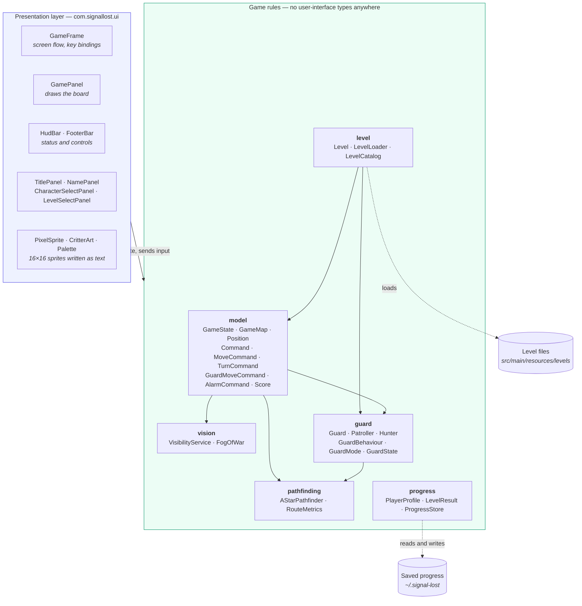
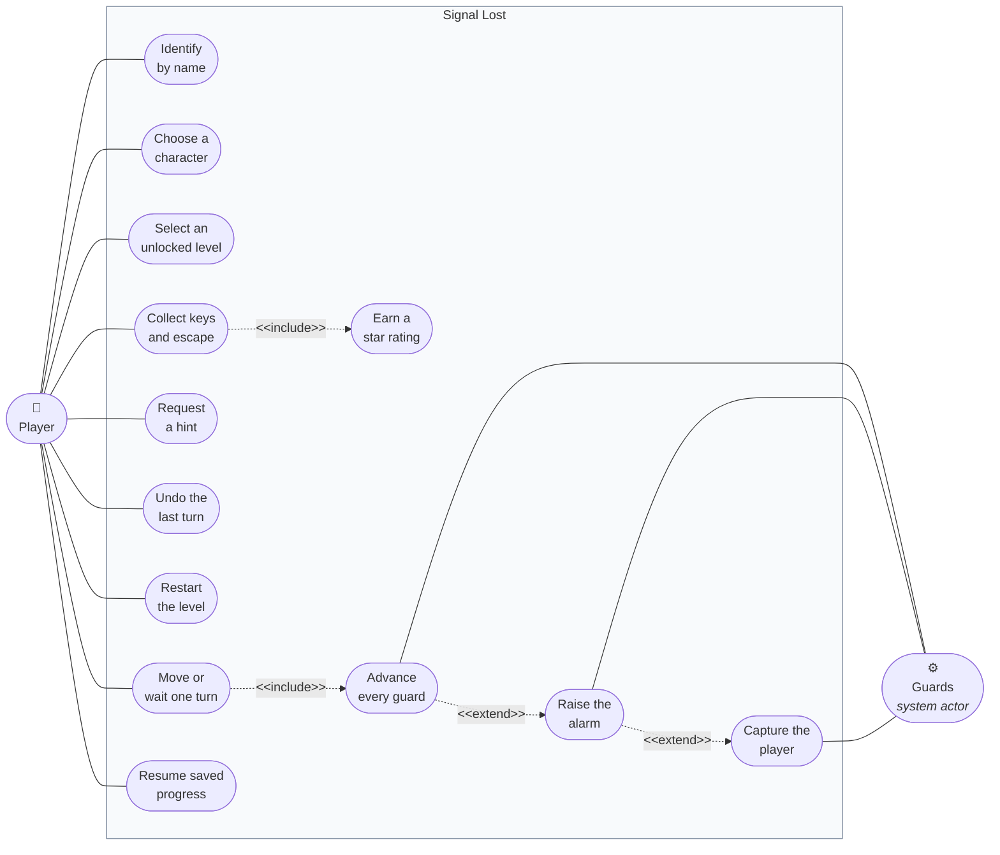
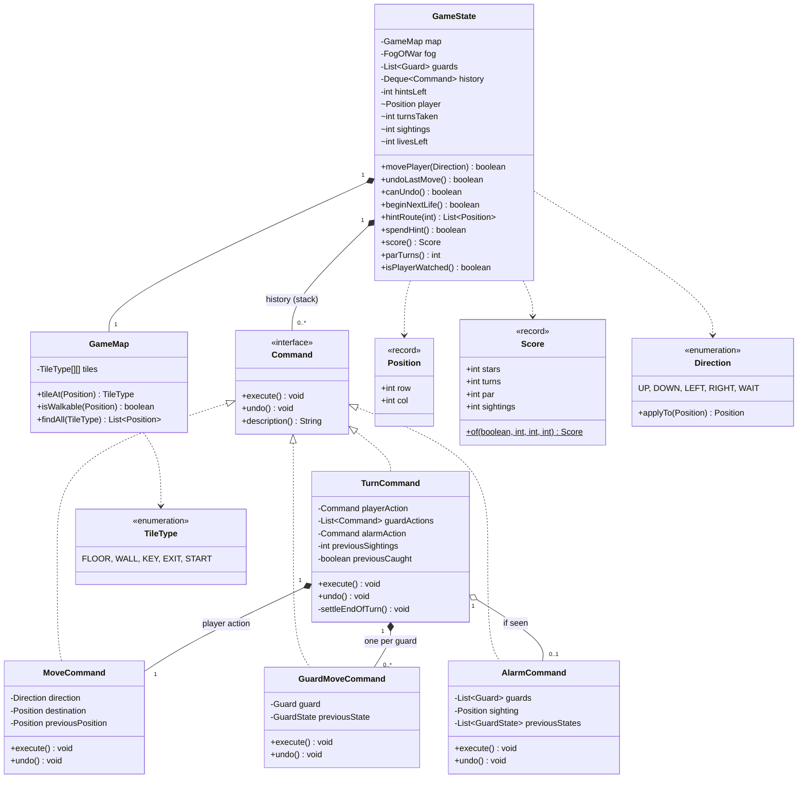
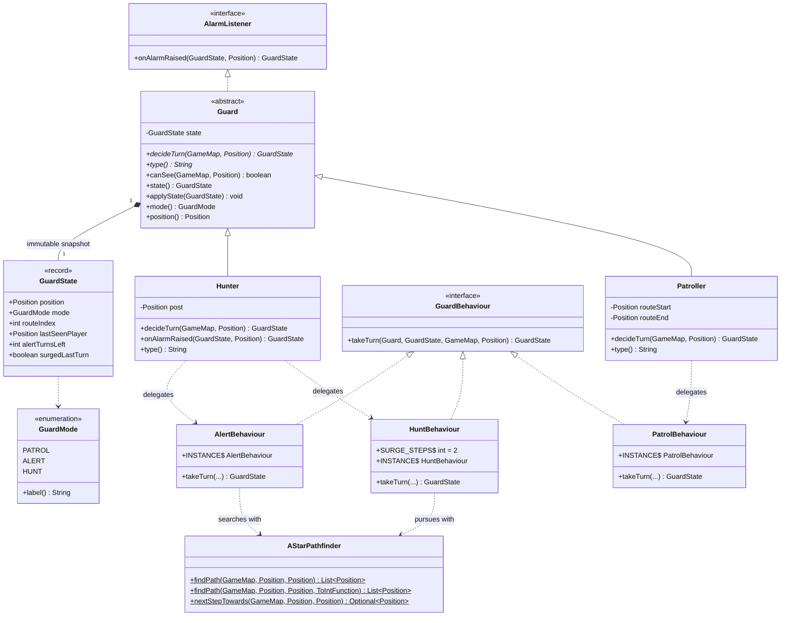
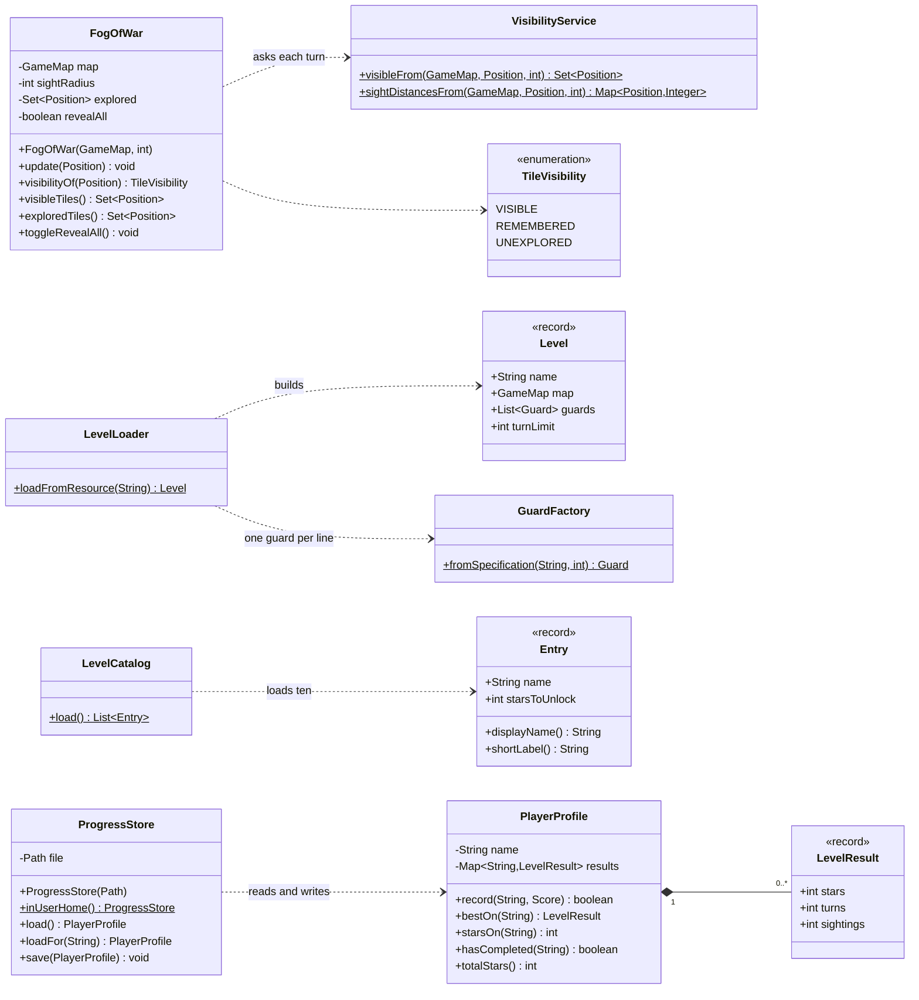
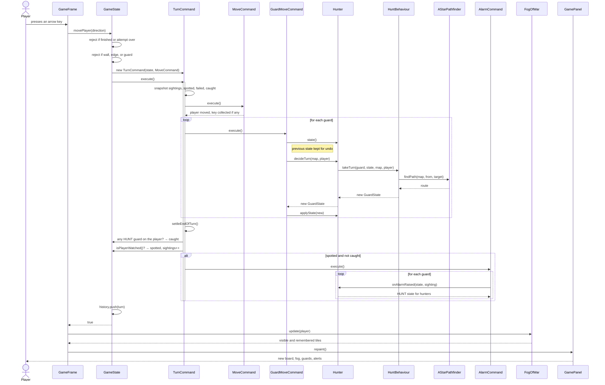
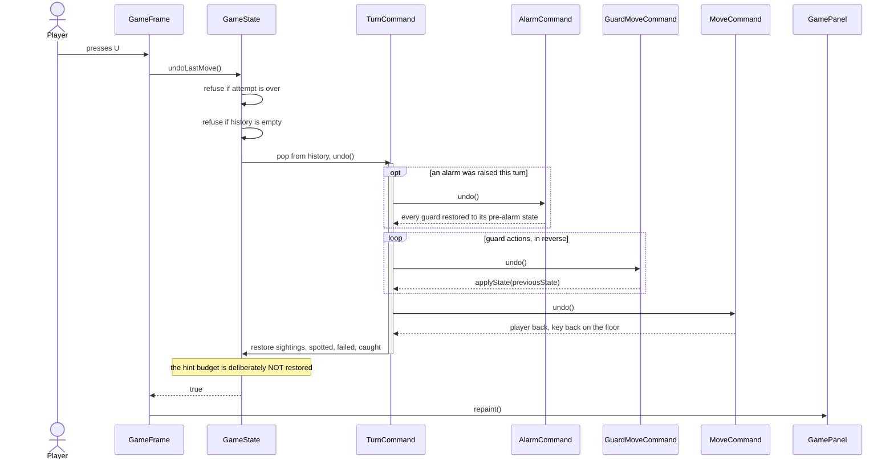
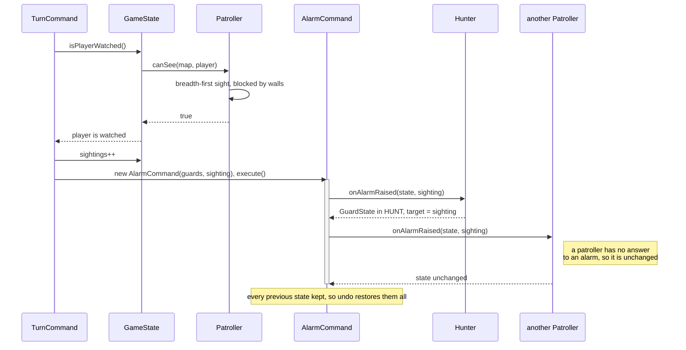
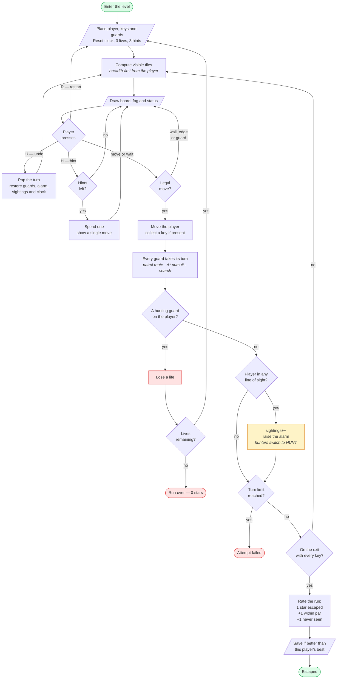
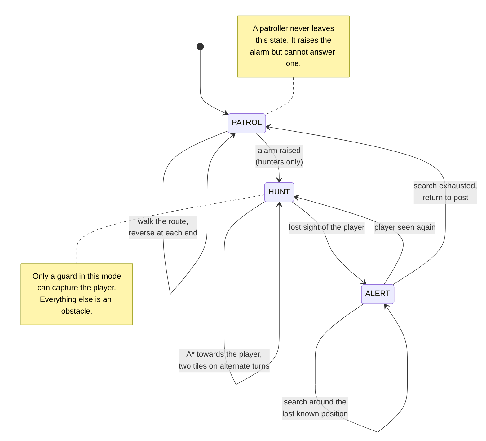

# UML diagrams

Section 5 of the [course report](report.md), drawn from the code as it stands
rather than from an earlier plan. Every class, method and relationship below
exists in `src/main/java/com/signallost`.

The diagrams are written as Mermaid source so that they render on GitHub, show
up meaningfully in a diff, and can be regenerated as images for the report by
`docs/render-diagrams.js`.

[&larr; back to the README](../README.md)

---

## 5.1 System architecture

Two layers, and the arrow between them points one way only. That direction is
enforced by `ArchitectureTest`, which fails the build if any package on the
lower half imports a user-interface type.

**Why the boundary is the architecture.** The rules may not know how they are
drawn. That single constraint is what lets the whole test suite run without
opening a window, and what would let the game move to another platform by
replacing only the upper half.

---

## 5.2 Use case diagram

| Use case | Actor | Description |
| --- | --- | --- |
| Identify by name | Player | Enters a name; progress is loaded for it, or started fresh |
| Choose a character | Player | Selects one of six characters for the run |
| Select an unlocked level | Player | Chooses from the levels their star total has unlocked |
| Move or wait one turn | Player | The primary interaction; always includes advancing the guards |
| Request a hint | Player | Spends one of three; shown one move, for one turn |
| Undo the last turn | Player | Rewinds player, guards, alarm, sightings and clock |
| Restart the level | Player | Abandons the attempt and begins again |
| Collect keys and escape | Player | Completing the objective; always produces a rating |
| Earn a star rating | Player | One star for escaping, one for speed, one for going unseen |
| Resume saved progress | Player | Best result per level is retained under their name |
| Advance every guard | Guards | Each guard acts after the player, per its mode |
| Raise the alarm | Guards | Extends guard movement when the player is sighted |
| Capture the player | Guards | Extends the alarm when a hunting guard reaches the player |

---

## 5.3 Class diagram

### 5.3.1 Core model and the Command pattern

Every turn is an object that knows how to undo itself. A `TurnCommand` owns the
player's action, one `GuardMoveCommand` per guard, and the alarm if one was
raised — which is why undo restores the guards and not merely the player.

### 5.3.2 Guards — State, Strategy and Observer together

Three patterns meet in one place. `GuardMode` is the **State**; `GuardBehaviour`
is the **Strategy** selected by that state; `AlarmListener` is the **Observer**
by which one guard's sighting reaches every other.

> **Why `GuardState` is a record.** A guard's whole condition — where it stands,
> what mode it is in, how far along its route it is, where it last saw the
> player, how long it will keep searching, and whether it surged last turn — is
> one immutable value. A
> `GuardMoveCommand` undoes itself by putting the previous value back, so undo
> is exact by construction rather than by remembering to reverse each field.

### 5.3.3 Vision, levels and progress

---

## 5.4 Sequence diagrams

### 5.4.1 One turn

The single most important flow in the system. Note the ordering: the player
moves first, then every guard, and only then is it decided whether the player
was seen. That order is the whole tension of the game — stepping somewhere safe
is not enough, because a guard may turn a corner and be looking at you by the
time the turn ends.

### 5.4.2 Undoing a turn

Undo is a pop and a reversal. Because the turn object holds the previous state
of everything it touched, nothing has to be recomputed — and nothing can be
missed.

### 5.4.3 Being seen, and the alarm reaching the hunters

---

## 5.5 Activity diagram

The flow of one complete attempt at a level, from entering it to the rating.

---

## 5.6 Guard state machine

The **State** pattern, drawn on its own because the transitions are the part
most often got wrong.

